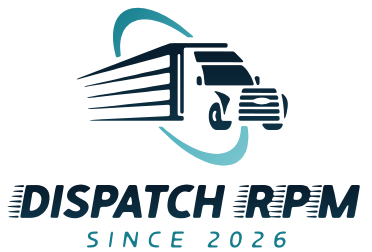

<p align="center">
  <picture>
    <source media="(prefers-color-scheme: dark)" srcset="docs/logo-dark.svg">
    
  </picture>
</p>

# Dispatch RPM

A desktop quoting tool for US truck dispatchers. Compare a broker's offer against loaded and all-in rates per mile, account for deadhead, and work out a counteroffer.

Dispatch RPM runs locally, with a Python backend and a browser-based interface. Quotes, settings, and rate history are stored in SQLite on your computer.


## Features

**Simple mode** evaluates an offer against reference rates and suggests whether to book, negotiate, or pass, with an opening counteroffer and minimum rate.

**Advanced mode** adds custom target and minimum rates, trip cost estimates, delivery-window checks, and saved quotes with outcome tracking.

Both modes share the current load details. The app also supports:

- ZIP-to-ZIP mileage and deadhead calculations
- LTL and partial loads with multiple pickups or drops
- Dry van, reefer, and flatbed rate references
- Company rates with optional diesel-price adjustments
- Saved-quote averages for today and the last 7 and 30 days, plus booked-rate history by lane
- CSV export

## Get started

### Windows download

Download `DispatchRPM.exe` from the [Releases page](https://github.com/IvanPopovski0/dispatch-rpm/releases) and run it. The packaged executable does not require a separate Python installation.

### Run from source

Requires Python 3.10 or newer and a web browser. The application uses Python's standard library; no additional Python packages are required to run it.

```bash
git clone https://github.com/IvanPopovski0/dispatch-rpm.git
cd dispatch-rpm
python -m dispatch_rpm
```

The app opens in a separate window when a supported Chromium-based browser is available, or in your default browser otherwise. The local server binds to `127.0.0.1`.

Common options:

| Option | Purpose |
| --- | --- |
| `--no-window` | Print the local URL and keep the server running without opening a window |
| `--port 8080` | Request a different local port |
| `--data-dir ./data` | Store the database and log in a chosen directory |
| `--offline-rates` | Disable online DAT and diesel-price checks |
| `--verbose` | Log every request |

For example:

```bash
python -m dispatch_rpm --no-window --port 8080
```

Use `python -m dispatch_rpm --help` for all options. `--offline-rates` is not a general offline mode: mileage lookups and an explicitly configured `--market-url` can still use the network.

## Mileage and rates

ZIP locations come from [Zippopotam.us](https://www.zippopotam.us/). Road-distance lookups use [OSRM](https://project-osrm.org/) with [OpenStreetMap](https://www.openstreetmap.org/copyright) data. These are car-routing estimates, not truck routes; verify the route and mileage before booking.

When routing is unavailable, the app can show a labeled straight-line estimate with a road-distance adjustment. A confirmed absence of a road route requires manual mileage instead. Delivery-window checks are rough scheduling estimates, not hours-of-service compliance calculations.

National reference rates use publicly available DAT market reports, with diesel-price data from the EIA through [FRED](https://fred.stlouisfed.org/series/GASDESW). The app checks for updates periodically and retains the last accepted rates when newer figures are unavailable. You can also enter national rates manually or use company rates for each equipment type.

National averages provide context for a quote; they do not establish the rate for an individual lane. Recommendations and cost estimates depend on the inputs and assumptions used.

### Team rates file

A team can share one set of national rates through a `market.json` file hosted at a URL, such as a raw GitHub link. Start the app with `--market-url <url>` to check it every six hours; it is off by default. The format is shown in [`market.json`](market.json): an `updated` date, all-in rates for `van`, `reefer`, and `flatbed`, and optional `linehaul` rates. The same checks apply as for DAT reports: a file with an all-in rate out of range is rejected, and a rate more than 20% from the last accepted one is held back until a report from another week agrees with it.

## Local data and network access

The database is named `dispatch.db`. Its default location is:

| Platform | Directory |
| --- | --- |
| Windows | `%APPDATA%\DispatchRPM\` |
| macOS | `~/Library/Application Support/DispatchRPM/` |
| Linux | `$XDG_DATA_HOME/dispatch-rpm/`, or `~/.local/share/dispatch-rpm/` when unset |

The application log, `dispatch-rpm.log`, is stored in the same directory. Use `--data-dir` to override this location.

Local storage does not mean all processing is offline. Automatic mileage lookups send ZIP codes to the location service and coordinates to the routing service. Rate updates also contact external sources.

## Development

The backend uses Python's standard library. The frontend is plain HTML, CSS, and JavaScript, with no frontend framework or build step.

Run the Python tests:

```bash
python -m unittest discover -s tests
```

Run the JavaScript tests with Node.js 20 or newer:

```bash
npm test
```

### Build an executable

Install the build dependencies, then run the packaging script:

```bash
python -m pip install -r requirements-build.txt
python build.py
```

PyInstaller creates a platform-specific executable in `dist/`. Build on the operating system you intend to distribute for.

### Report an issue or propose a change

Use [GitHub Issues](https://github.com/IvanPopovski0/dispatch-rpm/issues) for bug reports and feature proposals. For a bug, include the application version, operating system, reproduction steps, and expected versus actual behavior. Remove private load or broker details before sharing screenshots or logs.

Keep contributions focused. For behavior changes, include relevant tests and update affected documentation. Run both test suites before submitting a pull request, and note any checks you could not run.

## License and attribution

Released under the [MIT License](LICENSE).

Mileage and reference data are supplied by the services listed above. OpenStreetMap data is credited to its [contributors](https://www.openstreetmap.org/copyright).

This project is not affiliated with DAT Freight & Analytics.
