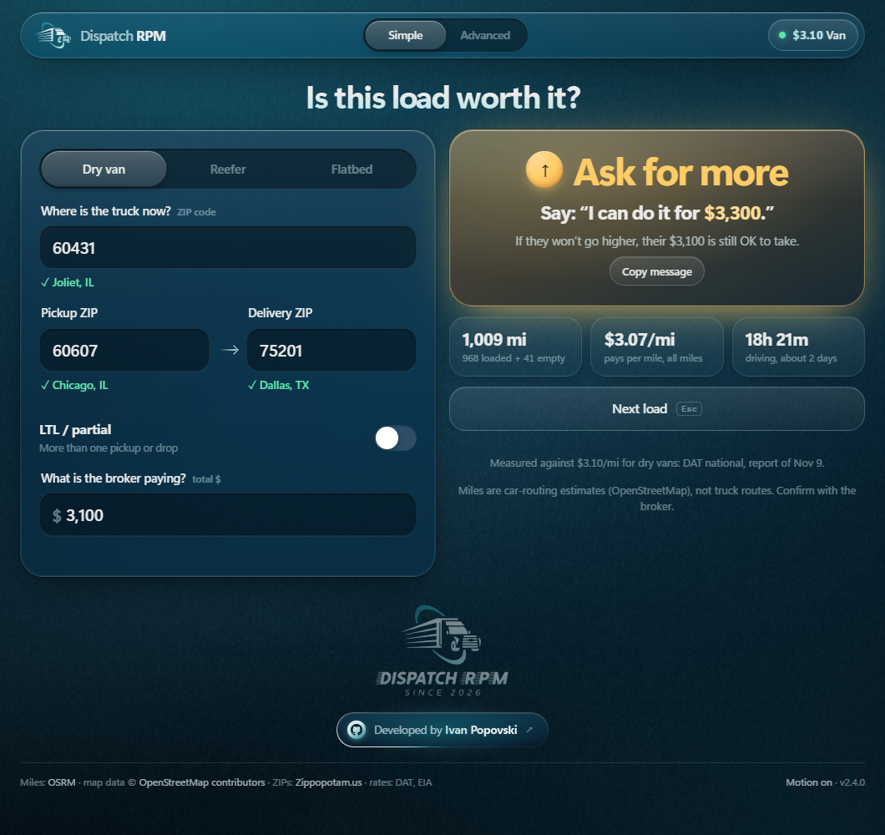

# Dispatch RPM

A desktop app for quoting truckloads while you're on the phone with a broker. Type where the
truck is, the pickup and delivery ZIPs and the offered rate, and it tells you right away whether
to take it, push for more, or walk away, and what to say.



Two modes in one app, switched from the toolbar. Whatever load you've typed comes along when you switch.

**Simple**, for new dispatchers. Five plain questions, one answer: **Take it**, **Ask for more** or
**Too low**, with the exact words to say back ("Say: *I can do it for $2,325.*"). Measured against
this week's national average, so there's nothing to set up.

**Advanced**, for everyone else. Your own target and walk-away $/mi, every number (all-in and
loaded $/mi, drive time, the rate for your target, market rate for the trip), saved quotes,
today / 7-day / 30-day averages and per-lane averages, CSV export.

Both modes:

- **Automatic miles.** ZIP-to-ZIP road miles, and empty miles from where the truck is now.
  Free, no API key, no account.
- **Rates that keep themselves current.** See [Rates](#rates) below.
- **Company rates.** If a manager gives you the rates to work from, enter them once under Rates;
  they replace the national average everywhere and are stored on your computer.
- **Keyboard first.** `Esc` clears the load (the truck location stays). In Simple, `Enter` moves
  to the next question; in Advanced it saves the quote.

## Install

### Windows

Download `DispatchRPM.exe` from the [Releases](../../releases) page and run it. Windows SmartScreen
may warn the first time because the exe isn't code-signed: **More info → Run anyway**.

It opens in its own window (Edge or Chrome in app mode, which every Windows machine has). Close the
window and the app exits.

### Linux / macOS (from source)

Needs Python 3.10+ and nothing else.

```bash
git clone https://github.com/<you>/dispatch-rpm.git
cd dispatch-rpm
python -m dispatch_rpm
```

With Chrome, Chromium, Brave or Edge installed it opens as an app window, otherwise in your default
browser. There's also a `DispatchRPM-linux` binary on the Releases page.

```
python -m dispatch_rpm --no-window      # just run the server and print the URL
python -m dispatch_rpm --port 8080      # default port is 47321
python -m dispatch_rpm --data-dir PATH  # keep the database somewhere else
python -m dispatch_rpm --offline-rates  # don't check DAT or diesel online
```

## How the answer is worked out

| | |
|---|---|
| **All-in $/mi** | rate ÷ (loaded miles + empty miles to pickup). |
| **Loaded $/mi** | rate ÷ loaded miles. Compared with the market, since DAT averages are per loaded mile. |
| **Simple** | Target is the reference rate (national or company) over all miles. At or above: take it. Up to 15% under: counter 5% above the reference, rounded to $25, and the broker's offer is still acceptable. More than 15% under: counter, and walk away below the minimum. Driving days use the 11-hour daily limit at 55 mph. Trips under 250 miles get a reminder that short hauls pay more per mile. |
| **Advanced** | Your own target and walk-away $/mi (Targets panel). The reference rate is shown alongside. |
| **Your averages** | Total dollars ÷ total miles over saved quotes, per truck type. Lanes group ZIPs by their first three digits, like DAT does. |

National averages don't know your lane. Outbound Florida pays less than outbound Chicago, for
example, so a new dispatcher should still learn their lanes.

## Rates

The reference $/mile for each truck type comes from the **Rates** panel (the rate chip, top right).

### National average (automatic)

DAT doesn't sell its rates through a free API, but it publishes a weekly national report per truck
type on its blog with the **linehaul** rate (fuel excluded). Every 12 hours the app:

1. Reads DAT's latest dry van, reefer and flatbed reports. It checks six places on dat.com (the blog
   feed, the market-update, van, reefer and flatbed category feeds, and the blog's WordPress JSON API),
   because no single one is reliably up to date. The newest report wins.
2. Reads the weekly U.S. diesel price (EIA, via [FRED](https://fred.stlouisfed.org/series/GASDESW)).
3. Works out the all-in rate: **DAT linehaul + fuel surcharge**. Each truck type's surcharge comes
   from a week where DAT published both numbers (built in: Oct 24–30, 2026, van $0.84, reefer
   $0.92, flatbed $1.01), then moves with diesel at the standard 1¢/mi per 6¢/gal.

Safety rails: a number is only accepted if it sits in a sane range and is within 20% of the week
before; otherwise it's held back and the panel says why. The parser only takes a sentence like
"*Dry van spot linehaul rates paid to carriers averaged $2.26 per mile*" from a report whose title
names that truck type, and ignores contract, top-lane and "bellwether states" figures. If nothing
can be reached, the last good numbers stay.

The panel shows each rate, where it came from and when each source was last checked. **Check now**
runs the update immediately.

**Edit by hand.** Type a number for any truck type; it's used until a newer DAT report comes in.
**Use DAT again** drops it.

**Team rates file (optional).** To push one set of numbers to every copy of the app, put them in
[`market.json`](market.json) and point `MARKET_URL` in [`dispatch_rpm/market.py`](dispatch_rpm/market.py)
at your repo (replace `YOUR_USERNAME`). The newest number by date wins, wherever it came from.

### Company rates

Switch the panel to **Company rates** and type the $/mi you've been told to work from, plus who set
them. They replace the national average in both modes. Leave a truck type empty to keep using the
national average for it. With **Adjust for diesel every week** on, they move with diesel from the
day they were set.

## Your data

Everything stays on your computer in a SQLite database:

| OS | Location |
|---|---|
| Windows | `%APPDATA%\DispatchRPM\dispatch.db` |
| macOS | `~/Library/Application Support/DispatchRPM/dispatch.db` |
| Linux | `~/.local/share/dispatch-rpm/dispatch.db` |

A log file (`dispatch-rpm.log`) sits next to it. The app only listens on `127.0.0.1`.

## Look and feel

Frosted glass over a still gradient field with a fine grain. Nothing moves behind the glass or
follows the pointer, so nothing flickers while you work. Color is kept for the answer: each verdict
has its own gradient and icon (green ✓ take it, amber ↑ ask for more, red ✕ too low, blue ! check
the offer), readable from the corner of your eye. On a normal-width window the answer sits beside
the questions, so it never scrolls out of view.

If an offer works out to several times the going rate (an extra zero, say), the app shows
**Check the offer** instead of a green light, and suggests the likely number.

Motion is limited to short, one-time transitions (the toggle sliding, the answer settling in).
**Motion on/off** in the footer turns it off, and the system's reduce-motion setting is respected.

## Development

```bash
python -m unittest discover -s tests   # backend tests
npm test                               # rate math and UI logic tests (Node 20+)
```

```
dispatch_rpm/
  app.py        entry point: starts the server, opens the window, exits when it closes
  server.py     local HTTP server and JSON API
  market.py     reference rates: DAT reports, diesel, market.json, hand-typed and company rates
  miles.py      ZIP lookup, routing, fallback estimate
  storage.py    SQLite: settings, quotes, rate history, caches
  static/       the UI (plain HTML/CSS/JS, no build step)
    main.js       app shell, mode switch
    simple.js     Simple mode       advanced.js  Advanced mode
    rates.js      Rates panel       load.js      the load shared by both modes
    calc.js       all the rate math, free of DOM code so it can be tested
    fx.js         motion: toggles, answer transitions, sheet
market.json     optional team rates file
```

### Building the executable

```bash
pip install pyinstaller
python build.py
```

The result is in `dist/`. PyInstaller builds for the OS it runs on, so build on Windows for the
`.exe`. Pushing a tag like `v2.0.0` does it automatically: the release workflow builds Windows and
Linux binaries and attaches them to a GitHub release.

## License

MIT. See [LICENSE](LICENSE).

Mileage uses OSRM with map data © [OpenStreetMap contributors](https://www.openstreetmap.org/copyright).
Diesel prices are from the U.S. Energy Information Administration, retrieved through FRED (Federal
Reserve Bank of St. Louis). National rates come from DAT Freight & Analytics' public weekly reports;
this project isn't affiliated with DAT.
